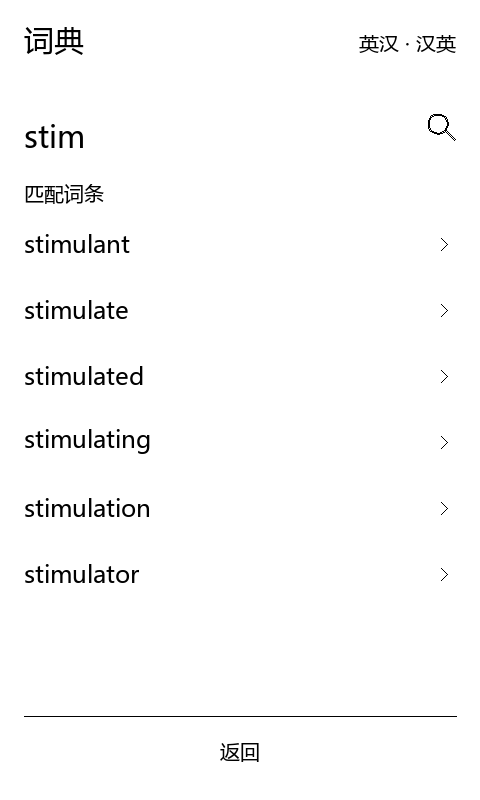
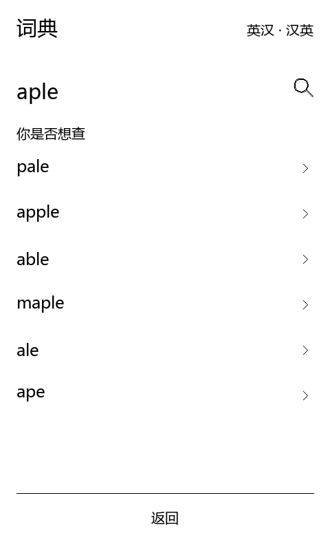
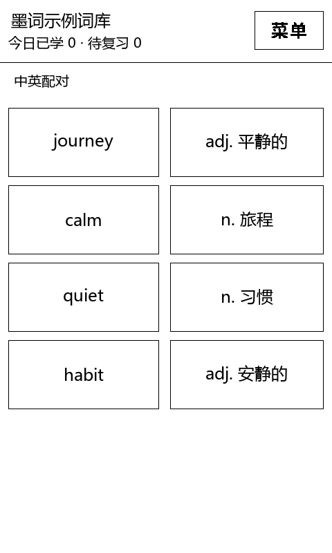

# 墨词 InkWords · X4 Pro

**WarlockDi** · **e99866@outlook.com** · 当前公开版 / Current release: **1.6.8**

针对阅星瞳 X4 Pro、XTOS Licorice 26111201、480×800竖屏的离线中英文学习小工具。离线查词与学习，无账号、联网依赖或后台服务；查词使用设备自带输入法。
Offline bilingual vocabulary practice and dictionary lookup for XTEINK X4 Pro. No account or background service; lookup uses the device input method.

[下载与详细更新 / Release](https://github.com/WarlockDi/InkWords-X4Pro/releases/tag/v1.6.8) · [安装 / Install](INSTALL.md) · [获取词库 / Get decks](docs/VOCABULARY.md) · [致谢 / Credits](THIRD_PARTY.md) · [作者与转载 / Authorship](AUTHORSHIP.md) · [贡献说明 / Contributors](CONTRIBUTORS.md)

## 本版更新 / What's new

- 离线英汉/汉英词典、词首候选、常用英文拼写建议；顶部点词查词，逐级返回。
- 单词本重启记页码；搜索结果显示条件与数量。
- 重选当前题型/筛选保留作答和页码；取消搜索回到更多。
- 总结子页返回一致；单页隐藏无效翻页，多页首尾停止。
- 有上限的缓存与按需读取，保持原有学习保存机制。

Offline dictionary and limited fuzzy suggestions; persistent word-book pages; clearer search results; consistent back/cancel behaviour; same-mode state retention and bounded pagination. [完整中英文更新说明 / Full bilingual notes](docs/releases/1.6.8.md)

## 安装与内容区别 / Installation and contents

| 情况 / Situation | 下载及操作 / Download and action |
| --- | --- |
| 1.6.6/1.6.7词典已可用 / Existing working dictionary | [仅安装 xtapp](https://github.com/WarlockDi/InkWords-X4Pro/releases/download/v1.6.8/InkWords_1.6.8.xtapp)，保留数据 / Update app only |
| 首次使用或从1.6.3增加词典 / First install or adding lookup | [完整ZIP](https://github.com/WarlockDi/InkWords-X4Pro/releases/download/v1.6.8/InkWords_1.6.8_Public.zip)，合并复制AppFiles并安装xtapp / Merge AppFiles and install app |

公开版与个人版使用同一程序。程序内含20条原创示例词卡，**不是只能学20个词**；已有词库与进度保留。公开ZIP另附约14.34 MB的许可词典数据，用于查词。个人108本考试/专业词书与抓取例句不公开附带，可按[词库指南](docs/VOCABULARY.md)自行导入有权使用的资料。
The app is the same; public downloads include 20 original demo cards, not a study limit, and optional attributed lookup data. Private study books and personal progress are excluded. No uninstall/reset is needed.

## 功能 / Features

英选中、中选英、例句填空、自适应拼写、双向配对、单词卡与随机组合；分类词库、最近练习、搜索收藏、错词复习、学习总结、每日新词不限量选项、确认后重置与恢复。基于上游FSRS实现加入保守记忆判定；“已学”不等于掌握。
Bilingual quizzes, cloze, adaptive spelling, bidirectional matching, flashcards, mixed practice, deck browsing, mistake review, summaries and confirmed resets. Review scheduling estimates familiarity; it does not certify mastery.

## 运行预览 / Runtime previews

以下为当前1.6.8实际Lua程序运行绘图，非AI效果图、非实机照片。缩略图160px，点击查看原图。
Current Lua runtime captures, not AI mockups or device photos; fonts and e-paper refresh can differ.

<table>
<tr>
<td align="center">查词 / Dictionary </td>
<td align="center">词首候选 / Prefix </td>
<td align="center">词条 / Entry </td>
</tr>
<tr>
<td align="center">拼写建议 / Suggestions </td>
<td align="center">拼写练习 / Spelling </td>
<td align="center">双向配对 / Matching </td>
</tr>
</table>

[更多页面 / More screens](docs/SCREENSHOTS.md)

## 稳定性与限制 / Validation and limitations

[测试记录](docs/TESTING.md)。电脑测试不代表实机延迟或耗电；首次打开部分页面仍可能等待。系统输入法关闭时可能短暂露出原查词页，按用户决定保留现状。尚未完成1.6.8长期实机验证。
Desktop tests do not measure hardware latency, power or endurance. First opens may take time; dismissing the system keyboard may briefly reveal the previous dictionary view. No blocking workaround has been introduced.

## 构建 / Build

Python 3.10+：`pip install -r requirements-dev.txt`，然后 `python tools/prepare_downloads.py`、`python build.py`。公开词典分块从校验后的发布ZIP提取，用户不需要在设备转换数据。
Run the commands above in a source checkout. Archive parts are transport files reassembled by the helper; install the Release ZIP, not individual parts.

## 作者与来源 / Author and sources

维护者 / Maintainer: **WarlockDi** · **e99866@outlook.com**。代码MIT；字体OFL；词典分别按ECDICT MIT、CC-CEDICT CC BY-SA 4.0。请保留作者、许可与修改说明。OpenAI Codex辅助开发，不是人类贡献者账号。

感谢 touch-licorice-apps、x4pro-emu、MemDeck、Anki/FSRS、Noto、ECDICT与CC-CEDICT作者。完整链接、变更及许可见 [THIRD_PARTY.md](THIRD_PARTY.md)。
