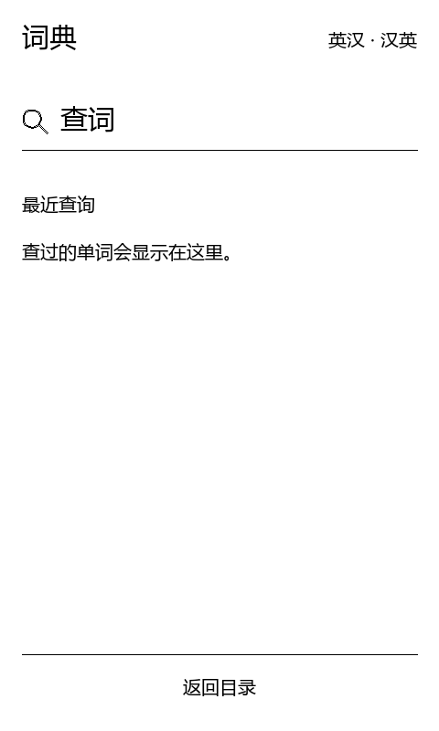
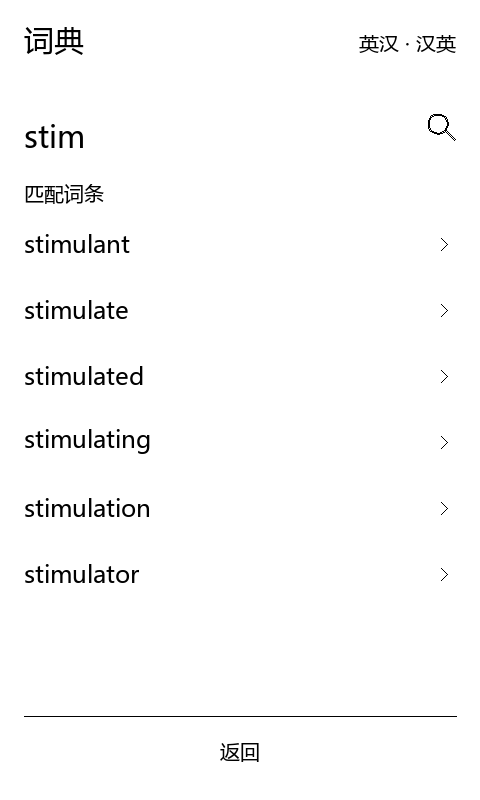
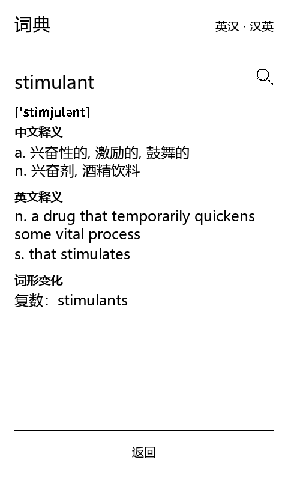
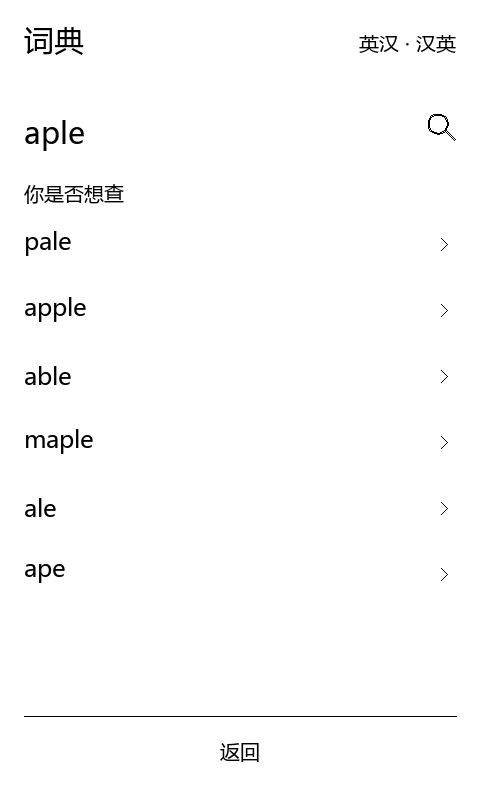
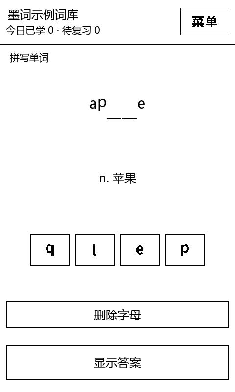
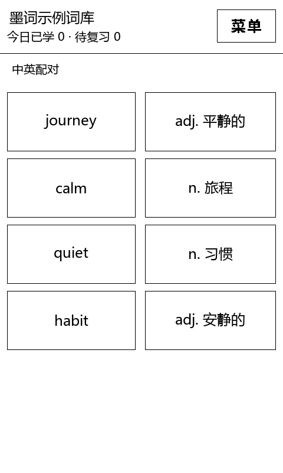
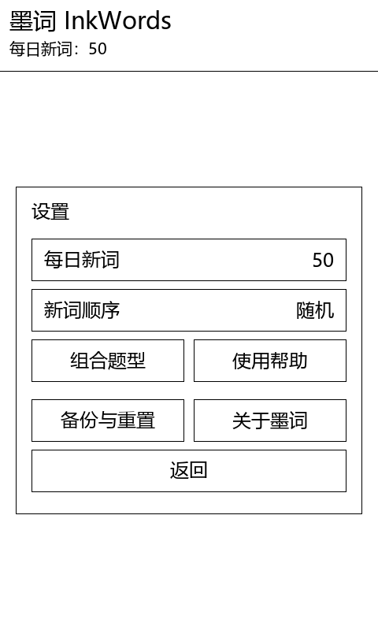
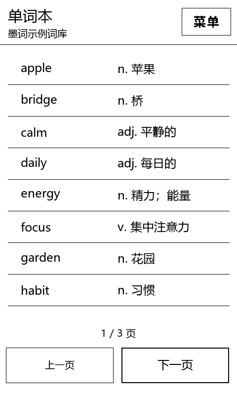
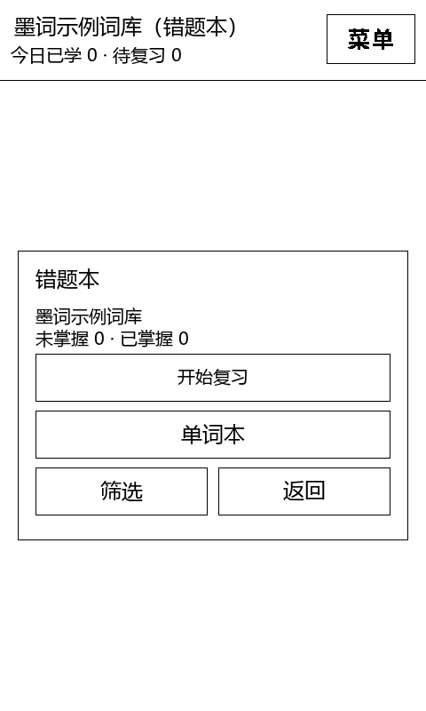

# 1.6.8 运行图 / Runtime screenshots

<table>
<tr>
<td align="center">查词 / Dictionary </td>
<td align="center">词首候选 / Prefix </td>
<td align="center">词条 / Entry </td>
</tr>
<tr>
<td align="center">拼写建议 / Suggestions </td>
<td align="center">拼写练习 / Spelling </td>
<td align="center">双向配对 / Matching </td>
</tr>
</table>

使用公开示例与许可词典数据，不含私人学习记录。Actual Lua drawings using public fixtures.

### 目录 / Directory

### 设置 / Settings

### 单词本 / Word book

### 错题本 / Mistake book

