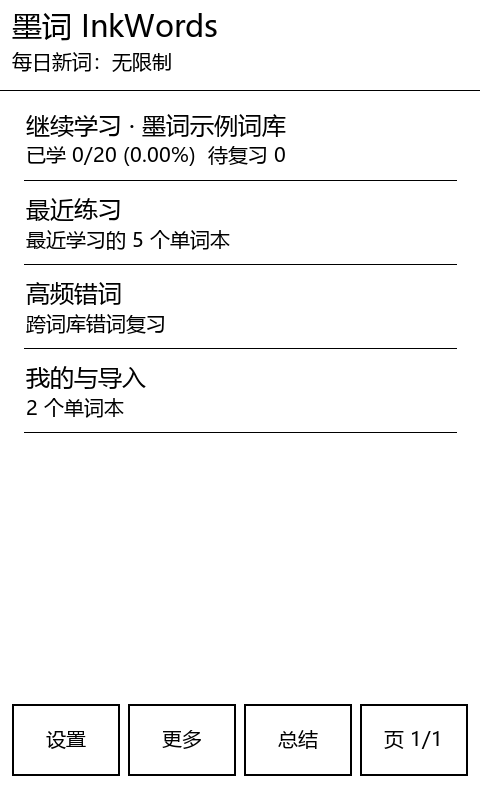
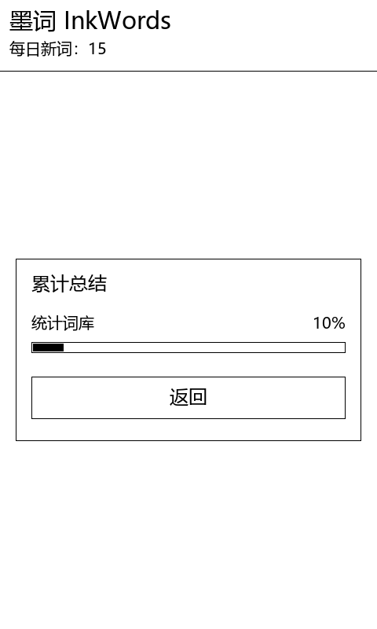

# 1.6.3 模拟运行图 / Runtime screenshots

实际Lua运行绘图，非AI生成、非实机照片。电脑字体与实机可能不同，进度百分比属于当前阶段。等待截图使用合成错词计数；其他页面使用原创示例词卡。

Captured from the actual Lua app in the desktop harness. These are not AI-generated mockups or device photographs. Desktop fonts differ; percentages measure the current stage. Loading screens use synthetic mistake counts; practice pages use original demo cards.

## 词库目录 / Directory

## 设置 / Settings

## 单词本 / Word book

## 错题本 / Mistake book

## 错题本进度 / Mistake loading

## 高频错词进度 / Aggregate loading

## 累计总结进度 / Summary loading

## 拼写 / Spelling

## 配对 / Matching

