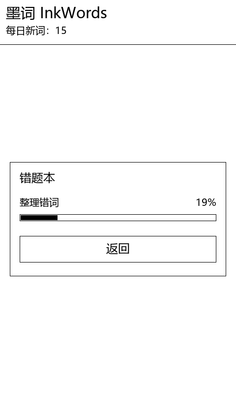
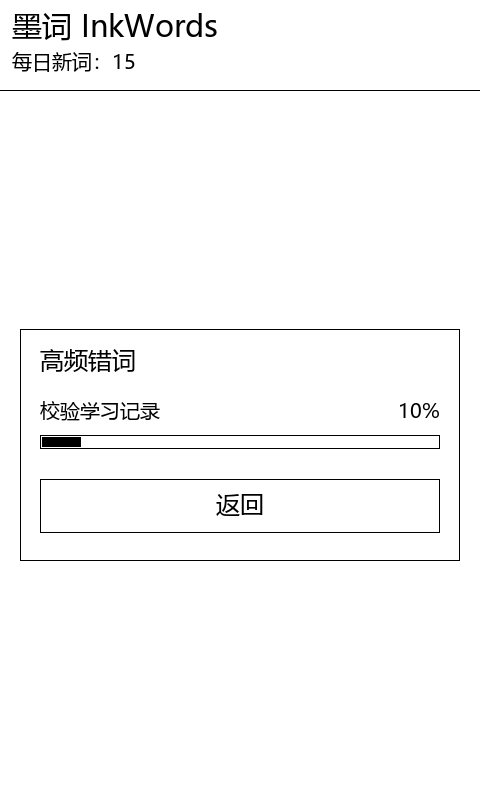

# 墨词 1.6.3 截图 / Screenshots

## 界面预览 / Runtime previews

1.6.3实际Lua模拟运行截图，非AI生成、非实机照片。点击小图查看原图。模拟字体与设备可能不同。
Actual Lua runtime captures, not AI-generated mockups or device photos. Click a thumbnail for full size; desktop fonts may differ.

<table>
<tr>
<td align="center">目录 / Directory </td>
<td align="center">设置 / Settings </td>
<td align="center">单词本 / Word book </td>
</tr>
<tr>
<td align="center">拼写 / Spelling </td>
<td align="center">配对 / Matching </td>
<td align="center">错题本 / Mistake book </td>
</tr>
</table>

查看三个等待进度页面 / Show loading progress screens

<table>
<tr>
<td align="center">错题本进度 </td>
<td align="center">高频错词进度 </td>
<td align="center">累计总结进度 </td>
</tr>
</table>

