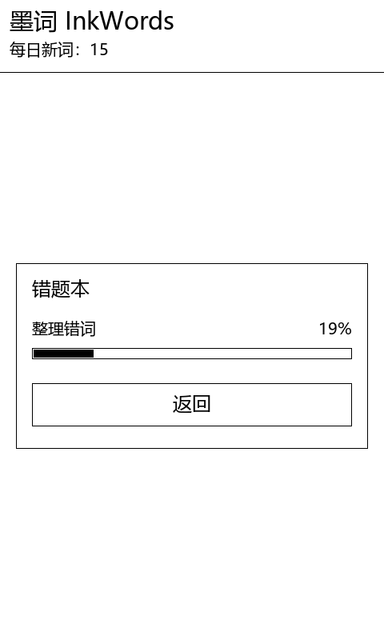

# 墨词 InkWords 1.6.3

这是自公开版 **1.5.4** 以来的累计更新；1.5.5–1.6.2 为本地测试迭代，不要求逐版安装。
This is the cumulative public update from **1.5.4**. Versions 1.5.5–1.6.2 were local test iterations; you do not need to install them first.

## 中文：具体更新

### 错题本、高频错词与单词本
- 每本词库的错题本优先进入复习，可筛选全部、已掌握与未掌握。掌握后保留记录，不直接消失。
- 高频错词汇总不同词库中的错误记录。同一英文词按规范化拼写合并展示，同时保留各词库的来源、释义与独立复习记录，不用一个解释覆盖所有来源。
- 单词本提供双栏英文与中文释义、翻页和总页数，本次使用中记住浏览位置；练习菜单可回看上一题，回看不撤销或重复计分。

### 等待进度提示（1.6.3）
- 错题本、高频错词和累计总结现在显示等待弹窗，可点“返回”取消，完成后自动进入结果。
- 有明确总量的阶段显示进度条与百分比；错词百分比表示当前阶段，切换阶段时会重新计数。未知总量的阶段显示当前处理内容，不伪造百分比。
- 累计总结按已经处理的词库数量更新进度；进度刷新有限频，不使用连续动画或额外动画定时任务。

### 目录、设置与帮助
- 目录底部重复的“帮助”入口改为“总结”；帮助统一在“设置 → 使用帮助”。设置采用紧凑按钮弹窗，练习题型与组合题型保持统一排版。
- 更新六页使用帮助，明确错词复习、题型、保存、重置等操作。
- 去掉“今日已学”后面的加号；重置名称说明是学习进度，保留二次确认与最近一次备份恢复。
- 释义与例句只有一页时不显示“页 1/1”，超过一页才显示翻页入口。

### 响应、缓存与保存
- 复用单库错题本和跨库高频错词的整理结果，并对重启后保存的索引进行校验。
- 已有错词次数变化时复用已知词条；新增错词按需补读缺少的词条块。变化后的列表仍需校验和排序，并非所有打开操作都能瞬间完成。
- 大进度文件答题时减少一次重复读取，保存日志和写后校验保留；下一题清理已完成题目时减少重复扫描。
- 连续配对逐笔保存可恢复日志，反馈后有序归并；只读菜单与释义避免不必要的等待。复用有上限的排版数据、合并待绘制刷新请求，不增加常驻后台服务。
- 保留词库和学习记录。派生缓存损坏时重建，不把缓存当作真实学习进度。

### 兼容修复与实际限制
- 修复本地测试版1.6.0在部分设备上启动时出现的 `number (local h) has no integer representation`；1.6.1起使用小数值分段校验，1.6.3已包含此修复。
- 为进度弹窗预留内存，降低大词量整理时同时驻留的临时数据量。
- 首次打开错题本、高频错词或累计总结仍可能等待数秒。本版增加真实的等待反馈，不宣称消除了所有延迟。
- 维护者已反馈1.6.3的本轮实机检查无问题。桌面模拟检查包含1000次随机操作、6000条来源记录、保存和缓存写入故障恢复；这些不等于实机延迟、耗电或长期可靠性认证。

## English: detailed changes

### Wrong-word review and word books
- Per-deck mistake books open into practice first and support All, Mastered and Not mastered filters. Mastered records remain available.
- Frequent wrong words aggregate across decks using normalized English spelling, while retaining source-specific meanings and review records rather than replacing all meanings with one definition.
- A two-column English/Chinese word book supports paging, total page counts and in-session position retention. Previous-question viewing does not undo or grade the answer again.

### Loading feedback in 1.6.3
- Mistake books, frequent wrong words and cumulative statistics now show cancellable loading dialogs and automatically display results when ready.
- Percentages measure the named stage, not the whole multi-stage operation. Unknown-size stages display status text only. Cumulative statistics count completed decks.
- Loading redraws are throttled; no continuous animation or additional animation timer is introduced.

### Navigation and presentation
- The directory's duplicate Help button becomes Summary; Help is available under Settings. Compact popup settings, practice selection and mixed-mode options use consistent layouts.
- Six help pages describe current review, exercise, persistence and reset behaviour. The daily-learned '+' suffix is removed and reset labels explicitly identify learning progress.
- Single-page definitions/examples hide the unnecessary 1/1 pager; multi-page content retains navigation.

### Performance, persistence and compatibility
- Validated separate mistake indexes are reused in-session and across restarts. Existing wrong-word spellings are cached in bounded blocks; new source words are loaded on demand. Changed lists still require validation and sorting.
- Large progress shards avoid one duplicate read on the answer path. Recovery journals and read-back verification remain in place; completed queue items are removed in one pass.
- Matching uses individually verified recovery journals followed by ordered merging; read-only views avoid unnecessary merge waits. Text-layout reuse and redraw coalescing remain bounded, with no background service.
- Includes the 1.6.1 fix for the local 1.6.0 wide-integer startup failure. Smaller merge batches leave memory headroom for the loading dialog. Canonical vocabulary/progress are preserved; damaged derived caches can be rebuilt.
- First opens can still take several seconds. This release does not claim instant loading or measured battery savings. The maintainer reports the requested 1.6.3 device checks passed; desktop stress/fault tests are not hardware timing or endurance certification.

## 安装与公开词库 / Installation and public vocabulary

下载 **InkWords_1.6.3.xtapp** 覆盖安装，不卸载、不重置、不必安装中间版本；已有词库无需重新复制。**Public.zip** 额外提供说明与许可证；GitHub自动生成的 Source code 不是安装包。

Install **InkWords_1.6.3.xtapp** over the existing app without uninstalling or resetting progress. Existing libraries are retained. **Public.zip** adds documentation/licenses; GitHub's Source code archives are not installers.

公开包包含20条原创示例词卡，用于体验功能，不是每日上限。不公开个人完整词库、抓取例句或学习记录；第一次使用示例库无需手动复制AppFiles。更多词库来源与导入方法见下方教程。

The public package contains 20 original demo cards, not a daily limit. Private dictionaries, scraped examples and user progress are excluded. Demo initialization is automatic; see the vocabulary guide for adding your own books.

## 最新模拟运行图 / Current runtime previews

以下图片来自1.6.3实际Lua程序在电脑测试环境中的绘图，不是AI生成图片，也不是实机照片。电脑字体、屏幕刷新和残影与设备可能不同。等待弹窗使用测试数据，未包含第三方词库正文或个人学习记录。

These are drawings captured from the running 1.6.3 Lua app in a desktop harness, not AI-generated mockups or device photos. Desktop fonts/rendering differ from hardware. Loading previews use test fixtures and do not expose private learning records or third-party vocabulary text.

### 错题本 / Mistake book

### 高频错词 / Frequent wrong words

### 累计总结 / Cumulative statistics

## 作者与致谢 / Authorship and credits

维护者 / Maintainer: **WarlockDi** · **e99866@outlook.com**. OpenAI Codex assisted development, debugging, simulated tests and documentation.

感谢 / Thanks: **Omer Faruk Inel / touch-licorice-apps** (MIT foundation and gamekit), **KFloyd.com / kycube / x4pro-emu** (packer), **MemDeck** (interaction references), **Anki / FSRS** (spaced-repetition references), **Adobe / Google / Noto contributors** (OFL fonts), and the vocabulary resource authors credited in THIRD_PARTY.md. Original notices and applicable licenses are retained.

[安装 / Installation](https://github.com/WarlockDi/InkWords-X4Pro/blob/v1.6.3/INSTALL.md) · [获取词库 / Vocabulary](https://github.com/WarlockDi/InkWords-X4Pro/blob/v1.6.3/docs/VOCABULARY.md) · [完整更新历史 / History](https://github.com/WarlockDi/InkWords-X4Pro/blob/v1.6.3/CHANGELOG.md) · [运行图 / Screenshots](https://github.com/WarlockDi/InkWords-X4Pro/blob/v1.6.3/docs/SCREENSHOTS.md) · [测试 / Testing](https://github.com/WarlockDi/InkWords-X4Pro/blob/v1.6.3/docs/TESTING.md) · [完整致谢 / Credits](https://github.com/WarlockDi/InkWords-X4Pro/blob/v1.6.3/THIRD_PARTY.md)
