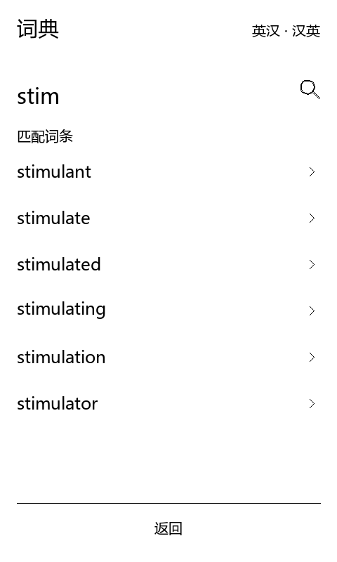
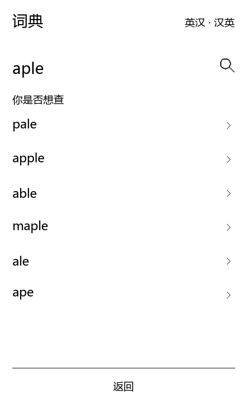
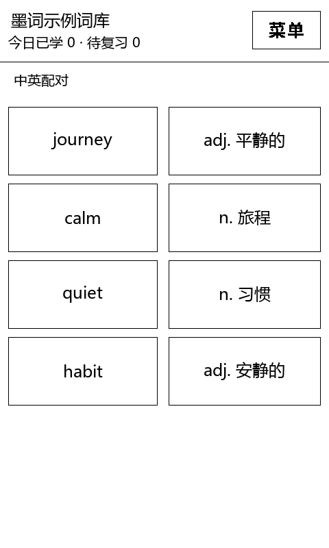

# 墨词 InkWords 1.6.8

由 WarlockDi 维护 / Maintained by **WarlockDi** · **e99866@outlook.com**

自公开版 1.6.3 起的累计更新；1.6.4–1.6.7 为本地迭代，无需逐版安装。
Cumulative update from public 1.6.3; intermediate local versions are not required.

## 中文

### 离线词典与查询

- 新增英汉/汉英查询：精确匹配、词首候选及部分常用英文词的单次编辑拼写建议。词典不是考试词库，也不是整句翻译工具。
- 按词条提供音标、中文释义、英文解释、词形变化；长内容分页，最近查询保留六条。
- 点击顶部词语或放大镜输入新查询，删除底部重复的“重新查询”。设备返回键与屏幕返回逐级返回，保留候选及词条页码。
- 重复查同一个词不重复加载；空输入和取消保留原页面；历史返回不改变最近查询排序；拦截重复或迟到回调。
- 查询索引按需读取，缓存数量有上限；返回候选及重绘不重复读取数据。高内存压力时回收，减少漏候选风险。
- 未安装数据与读取异常分别提示。系统输入法关闭后仍可能短暂露出原查词页，本版不增加新的输入法阻塞或切换逻辑来隐藏该现象。

### 学习与其他交互

- 单词本按词库保存阅读页码，重启后恢复。
- 词库搜索结果显示查询条件和结果数量；目录底部提供词典，总结移至更多。
- 重选当前题型保留当前题、队列与作答状态；重复选择当前错词筛选保留页码。
- 搜索词库取消返回更多；相同搜索不重置页码，不重复请求进度汇总。
- 总结、统计说明、今日错词和词库进度详情按来源返回，设备返回键不跳过父页。
- 单页总结列表和句子讲解隐藏翻页；多页到首尾停止，不循环回首页。
- 保持现有答题布局、计分与进度保存机制。

### 下载与安装

- **词典已在 1.6.6/1.6.7 正常使用**：只下载 InkWords_1.6.8.xtapp，覆盖安装。
- **首次安装或从公开版 1.6.3 升级并希望使用词典**：下载 InkWords_1.6.8_Public.zip，解压后将 xtapp 与 AppFiles 一起复制至阅读器根目录；合并保留现有 AppFiles，安全弹出后安装 xtapp。
- 不需卸载、重置或先装中间版本。首次启动初始化20条原创示例词卡，这是演示内容，不是学习数量限制。私人108本词书、抓取例句与用户进度不在公开包内。
- 词典数据约14.34 MB，625个 dict1_*.txt 分块文件；运行时按需读取，不整体装入内存。公开ZIP约7.45 MB。

### 验证与边界

电脑检查包括：1 MiB 模拟Lua堆下七种题型；250次连续查词与导航；160次混合查询；6000组编辑距离和500组前缀对照；100次讲解/释义切换；96种配对保存故障恢复；重置取消、书签和跨页返回检查。更早的本轮检查包含1000次固定种子混合答题/导航/重启。
这些不是实机毫秒耗时或耗电测试。用户已确认词典可用；1.6.8整包长期实机验证未完成，不宣称无延迟或零崩溃。

## English

This release adds an offline English–Chinese / Chinese–English dictionary with exact and prefix lookup, limited one-edit suggestions for common English words, six recent queries, phonetics, definitions, inflections and pagination. Tap the query heading or magnifier to search. Back restores the previous dictionary page; same-query submissions and redraws avoid redundant reads. Data is read in bounded shards with limited caches, not loaded wholesale.

Word books retain per-deck pages across restarts. Deck-search results show the query and count. Reselecting the active exercise or mistake filter preserves state. Cancelling deck search returns to More; repeated searches retain pages. Summary subpages now return to their parent. Single-page sentence explanations hide the pager; multi-page navigation stops at the ends. Existing answer layouts and canonical progress-saving behaviour remain intact.

Install only the xtapp if the 1.6.6/1.6.7 dictionary already works. Otherwise download the Public ZIP and merge its AppFiles into the reader root alongside the xtapp, safely eject, then install. Do not uninstall or reset. The app includes 20 original demonstration cards, not a usage limit; the private 108-book collection and personal progress are excluded. The optional lookup data occupies about 14.34 MB in 625 indexed files, separate from study decks.

Desktop checks cover a simulated 1 MiB heap, seven exercise modes, query/navigation stress, independent matching comparisons, explanation loops and persistence fault recovery. They do not establish real-device latency, energy consumption or long-term reliability. The system keyboard may briefly expose the prior dictionary screen when dismissed; no new blocking workaround is included.

## 运行预览 / Runtime previews

1.6.8 实际 Lua 程序绘图，非AI生成、非实机照片。点击160px缩略图查看原图；字体与墨水屏刷新可能不同。
Actual Lua runtime drawings, not AI mockups or device photos; click a thumbnail for the full image.

<table>
<tr>
<td align="center">查词 / Dictionary </td>
<td align="center">词首候选 / Prefix </td>
<td align="center">词条 / Entry </td>
</tr>
<tr>
<td align="center">拼写建议 / Suggestions </td>
<td align="center">拼写练习 / Spelling </td>
<td align="center">双向配对 / Matching </td>
</tr>
</table>

## 致谢 / Credits

感谢 Omer Faruk Inel / touch-licorice-apps（MIT基础与gamekit）、KFloyd.com / kycube / x4pro-emu（打包器）、MemDeck（交互参考）、Anki / FSRS（复习理念）、Noto贡献者（OFL字形）、skywind3000 / ECDICT（MIT英汉数据）及CC-CEDICT社区（CC BY-SA 4.0汉英数据）。OpenAI Codex辅助开发、调试、测试和文档。各自许可、作者声明和来源保留，详见 THIRD_PARTY.md。
